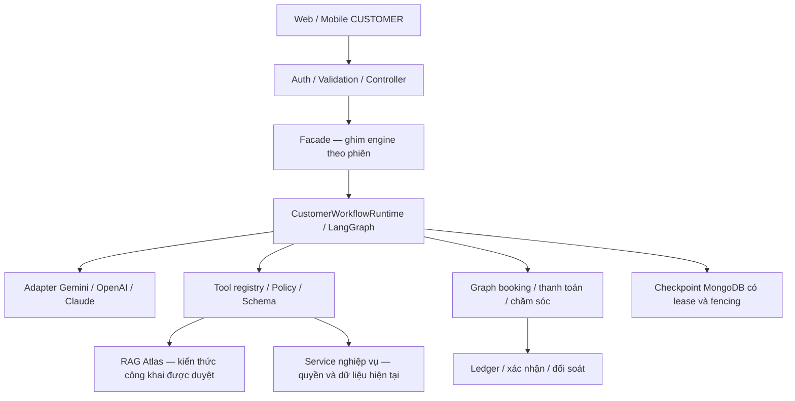

# Agent Booking Handigo — trạng thái triển khai

Cập nhật: **28/10/2026**.

Rà soát nghiệp vụ ngày 28/10: đã sửa phục hồi sau giờ hẹn, phân loại lỗi trước ghi, xác nhận chính sách trên Flutter, hiển thị cách lưu địa chỉ trên web và số sao trên Flutter. Bộ backend đạt 46/46 tệp kiểm thử, web đạt 18/18 lượt trên hai kích thước, Flutter đạt 11/11 ca agent. Xem [báo cáo rà soát và giới hạn kiểm chứng](handigo-backend/docs/agent-booking-audit-2026-10-28.md). Kết quả này dùng nguồn dữ liệu/model/cổng thanh toán giả lập; không thay thế nghiệm thu tích hợp thật ở mục 6.

**Cấu trúc agent mới đã được triển khai và bật cho phiên CUSTOMER mới trong môi trường local.** LangGraph điều phối hội thoại và nghiệp vụ; RAG dùng MongoDB Atlas; Gemini hoạt động với cấu hình hiện có. Kiểm chứng HTTP bằng tài khoản CUSTOMER được chủ dự án chỉ định đã đạt. Chưa nghiệm thu toàn bộ môi trường production: còn kiểm thử giao diện với tài khoản thật, giao dịch trong môi trường thử nghiệm và diễn tập vận hành. Kiểm tra tải để cuối theo yêu cầu.

## 1. Tiến độ G0–G6

| Giai đoạn | Phần đã triển khai | Bằng chứng / giới hạn |
| --- | --- | --- |
| G0 — Nền tảng | Kiểm kê tool/contract, dependency, driver/checkpointer, cấu hình và chỉ mục Atlas | Readiness thật đạt; baseline dưới tải chưa chốt |
| G1 — An toàn | Kiểm tra quyền/ownership/schema/policy, preview/xác nhận, chống request lặp và đối soát | Bộ hồi quy backend; không tự đổi thanh toán từ lời gọi model |
| G2 — RAG | Nhập nguồn được duyệt, chia đoạn, embedding, worker có lease/retry, phiên bản/manifest, thu hồi, hybrid retrieval | 15 nguồn/18 đoạn đã công bố; retrieval khởi đầu 9/9; worker/revocation đã kiểm chứng trên Atlas |
| G3 — Hội thoại | Graph điều phối 16 node, checkpoint có fencing, facade ghim engine, phục hồi model và làm mới nguồn đọc | Gemini/RAG/Atlas 5/5; HTTP tài khoản thật đạt; còn failover và giao diện thật |
| G4 — Booking | Bản nháp, địa chỉ, lịch, voucher, thợ, đặt lại, preview/consent, graph tạo đơn và ledger | Hồi quy crash/replay/đồng thời đạt với service fixture; chưa nghiệm thu đơn thật |
| G5 — Thanh toán/chăm sóc | Graph thanh toán/hủy QR/đổi phương thức, báo giá, hỗ trợ, khiếu nại, đánh giá và phục hồi theo dõi | Ma trận tool/runtime đạt với service fixture; chưa nghiệm thu PayOS/tiền thật |
| G6 — Vận hành | Rollout off/pilot/all, giữ engine phiên cũ, log từng bước/token, báo cáo JSON/HTML, CLI báo trạng thái cần kiểm tra và runbook đối soát/rollback | Local đã bật all + RAG; kiểm tra tải/ngưỡng và diễn tập production còn lại |

Các thành phần tái cấu trúc lõi nêu trên đã có trong code. Hoàn tất mã nguồn không đồng nghĩa đã nghiệm thu mọi tình huống nghiệp vụ hoặc production. Những ghi chú “chưa triển khai” trong lịch sử phải đọc theo thời điểm, không phải danh sách tồn đọng hiện tại. Giới hạn chức năng và các bước chưa nghiệm thu được ghi ở mục 2 và mục 6.

## 2. Cấu trúc đang chạy



- Graph hội thoại: `route_request`, `history_request`, `voucher_request`, `recover_draft`, `recover_address`, `compact_context`, `call_model`, `route_tool`, `validate_tool`, `prepare_confirmation`, `execute_read`, `after_tool`, `prepare_draft`, `apply_address`, `respond`, `refresh_sources`.
- Graph con lưu frame vào checkpoint phiên chuẩn; không tạo kho tiến độ độc lập. Khi tiếp tục, backend dùng phase đã lưu; client không chọn engine/node/checkpoint.
- `ai_customer_graph_threads` giữ metadata/lease; `ai_graph_checkpoints` và `ai_graph_checkpoint_writes` giữ checkpoint; `ai_agent_actions` giữ ledger. `ai_agent_sessions` là directory/cache đối với engine mới.
- Kiến thức dùng `ai_knowledge_documents`, `ai_knowledge_versions`, `ai_knowledge_chunks`, `ai_knowledge_jobs`. Không đưa dữ liệu riêng của khách vào RAG công khai.
- Thông tin dịch vụ, tùy chọn, giá và quy trình hiện tại đọc từ service nghiệp vụ qua tool. Chưa tự sao chép collection dịch vụ vào RAG; tránh dùng vector snapshot để quyết định giá/điều kiện đặt đơn.
- Tool chia 5 nhóm booking/support/complaint/order/payment, dùng chung tool kiến thức và thông tin hệ thống. Yêu cầu có một nhóm rõ ràng được backend nạp sẵn từ tin nhắn mới nhất, bỏ lượt model chỉ để chọn nhóm; câu mơ hồ/kết hợp giữ `select_tool_group`. Chuyển nhóm thay thế danh sách cũ và vẫn kiểm tra quyền. Prompt yêu cầu chỉ đọc dữ liệu phục vụ tác vụ, tận dụng kết quả cùng lượt và không tra lại dữ liệu đã có trong kết quả bản nháp. Đây là chỉ dẫn cho model, chưa phải bảo đảm mọi câu đều chọn tool tối ưu; chưa đo lại độ trễ Gemini/Atlas sau thay đổi định tuyến.
- Web chọn voucher trong trường **Mã giảm giá** dưới **Đơn giá** của form xác nhận, chỉ hiện khi có mã hợp lệ và mặc định không dùng mã. Chọn/bỏ mã gửi cập nhật có revision, backend tính lại giá và cấp xác nhận mới; không tự tạo đơn hoặc thanh toán. Không hiển thị nhóm chọn mã riêng dưới form.
- Bộ nguồn ngoài hiện nhận JSON chứa văn bản/Markdown đã duyệt. Tự trích xuất PDF/ảnh/URL và đồng bộ catalog định kỳ là khả năng mở rộng, chưa được cung cấp trong bản này.

## 3. Quy tắc bắt buộc khi bảo trì

- Xác thực CUSTOMER và ownership từ dữ liệu server; không tin userId/role do client hoặc model khai báo.
- Model chỉ đề xuất công cụ. Service kiểm tra điều kiện và quyết định kết quả nghiệp vụ; thao tác ghi phải có preview/xác nhận hợp lệ và consent khi yêu cầu.
- Ledger chưa rõ kết quả giữ trạng thái cần đối soát. Không tự gọi lại thao tác ghi, ép trạng thái hoặc xóa bản ghi để mở khóa.
- Hoàn tiền PayOS mới đi vào ví Handigo theo số tiền được phép hoàn; không tạo PayOS Payout mới. Lệnh chi ngân hàng cũ đã gửi hoặc chưa rõ kết quả phải đối soát trước, không cộng ví thêm. Đã xác minh khoản 120.000đ của đơn `ORD-2567D7C1A111` hoàn về ví một lần, Order/Payment `refunded` và Refund `succeeded`.
- Receipt hoàn tất bảo vệ request lặp. Timeout/lỗi model tạm thời giữ request dở; nút Thử lại gửi đúng request để tiếp tục. Nguồn đọc trong allowlist được làm mới, thao tác ghi không phát lại.
- Snapshot checkpoint không đổi được bỏ ghi thừa. Giữ checkpoint ở ranh giới quan trọng và kiểm tra lease trước ghi.
- Thao tác giao diện chỉ chọn/bỏ voucher trên form còn chỉnh sửa dùng graph bản nháp hiện có và chốt form + receipt trong một checkpoint; không chạy model hoặc tạo hành động ghi nghiệp vụ. Lỗi giá/mã và yêu cầu kết hợp giữ luồng phục hồi đầy đủ.
- Runtime 180 giây; socket riêng POST `/ai/messages` 195 giây; web chờ 200 giây.
- Không xóa dữ liệu, tự tạo TTL, drop index, migrate phiên hoặc bỏ engine cũ. Chỉ bỏ code cũ khi hết phiên phụ thuộc hoặc đã có migration được kiểm chứng.
- Không sao chép URI/key/token từ `.env` vào code, tài liệu hay báo cáo. Các script dùng cấu hình tiến trình; chỉ nạp `.env` khi đã được chủ dự án cho phép.

## 4. Cấu hình và sử dụng

Cấu hình local đã bật:

```dotenv
AI_AGENT_CUSTOMER_ROLLOUT=all
AI_KNOWLEDGE_ENABLED=true
```

Model chat dùng `AI_AGENT_PROVIDER`, `AI_AGENT_MODEL` và key tương ứng đang có trong `.env`. Không cần thêm ID của từng khách khi dùng `all`. `pilot` chỉ dành cho nhóm thử nghiệm; `off` dừng chọn engine mới cho phiên mới. Phiên cũ vẫn giữ engine đã ghim, kể cả khi đổi rollout.

Embedding đang dùng adapter Gemini với 768 chiều và ngưỡng truy xuất đã đánh giá. Đổi model chat và đổi embedding là hai việc độc lập. Đổi nhà cung cấp embedding cần tạo lại vector/index theo generation mới, kiểm chứng rồi chuyển cấu hình; không dùng vector Gemini cũ với embedding OpenAI.

Địa chỉ local đã khởi động: web `https://localhost:5173`, backend cổng `5000`. CUSTOMER đăng nhập và tạo cuộc trò chuyện/tác vụ mới để dùng engine mới. Trạng thái tiến trình phụ thuộc phiên máy đang chạy, không phải cam kết dịch vụ production.

## 5. Kiểm chứng đã hoàn tất

| Kiểm tra | Kết quả |
| --- | --- |
| Backend `npm run test:agent` | Build TypeScript và 46/46 bài đạt; có nạp nhóm tool theo yêu cầu rõ ràng, chuyển nhóm/mơ hồ và crash/replay không lặp model; hoàn PayOS về ví và cập nhật voucher một checkpoint |
| Web build | Đạt |
| Flutter `ai_chat_tools_test.dart --no-pub` | 7/7 |
| Web component với API fixture | Phục hồi model, ảnh, xác nhận, địa chỉ, thẻ hành động và hủy QR; màn hình rộng/hẹp theo các ca tương ứng |
| Readiness cấu hình thật | Model, rollout, storage, index/manifest RAG và model probe đạt |
| Gemini + RAG + checkpoint Atlas | 5/5 ca QR/voucher/khiếu nại/thiếu nguồn/ngoài phạm vi; trả lời ngay lần đầu, replay không gọi thêm model |
| Khôi phục ledger/checkpoint Atlas | Hai kết nối; đóng client cũ, tiếp tục bằng client mới; không lặp tool; sai chủ bị chặn |
| HTTP CUSTOMER thật được chỉ định | Auth/controller/facade/Gemini/RAG thật; hỏi chính sách voucher, GET phiên/tiến độ, replay đạt; không tạo hành động nghiệp vụ |
| Đóng vai khách hàng qua HTTP thật | 5 ca danh mục/chính sách/ngoài phạm vi/lịch sử đơn đạt; chạy lại riêng booking sau sửa kỳ vọng test đạt 6/6, gồm chat đổi số lượng, thao tác giao diện, từ chối, tab cũ và replay |
| Chọn/bỏ voucher trên Atlas | Hai thao tác đo runtime: 9,05/9,39 giây trước → 4,70/4,91 giây sau; checkpoint 6 → 1, không gọi model. Chưa gồm HTTP/auth/directory, chưa phải kết quả tải hoặc SLO |

Bằng chứng:

- Voucher Atlas [trước tối ưu](handigo-backend/docs/evaluations/voucher-runtime-before-1793112638941.json) và [sau tối ưu](handigo-backend/docs/evaluations/voucher-runtime-after-1793112970895.json): service đọc thật, phiên AI riêng, không tạo đơn/thanh toán hoặc xóa dữ liệu. Script `src/scripts/profileAgentVoucherAtlas.ts`.
- [Hội thoại Gemini/Atlas — 5/5](handigo-backend/docs/evaluations/customer-agent-atlas-1793085319150.json).
- [HTTP bằng CUSTOMER thật](handigo-backend/docs/evaluations/customer-agent-http-atlas-1793086406421.json).
- [Lần chạy hội thoại đầu](handigo-backend/docs/evaluations/customer-journey-atlas-1793087544751.json): 8/10 check đạt; hai check tab cũ/replay đặt kỳ vọng sai contract, không phải bằng chứng lỗi production. Tab cũ trả HTTP 200 kèm từ chối; replay trả projection hiện tại kể cả tin nhắn sau request cũ. Giữ nguyên API, sửa bài test rồi chạy lại booking.
- [Booking sau sửa kỳ vọng test — 6/6](handigo-backend/docs/evaluations/customer-journey-atlas-1793087699462.json). Tổng hai lượt có 11 kịch bản khác nhau với kết quả mới nhất đạt; đây không phải một lần chạy toàn bộ 11/11. Các check câu trả lời chính sách là heuristic theo nội dung/tên tool, không phải đánh giá ngữ nghĩa toàn diện. Script tái hiện: `src/scripts/evaluateCustomerJourneyAtlas.ts`, nhận email CUSTOMER qua biến tiến trình `AI_AGENT_E2E_CUSTOMER`.
- Thời gian lượt của bộ 5 ca khoảng 14–25 giây; một ca HTTP gồm cả đọc lại/replay/xác minh khoảng 21,7 giây. Đây là bộ nhỏ tuần tự, không phải SLO hay kiểm tra tải.
- Kiểm thử HTTP ký JWT ngắn hạn trong bộ nhớ và đi qua middleware thật. Không kiểm thử thao tác nhập mật khẩu/đăng nhập trên trình duyệt. Chỉ lưu phiên/checkpoint AI; không sửa tài khoản, tạo đơn/thanh toán hoặc xóa document.
- Hội thoại đóng vai khách ghi nhận lượt chat khoảng 17–46 giây, thao tác đổi số lượng có cấu trúc khoảng 11 giây. Riêng danh mục mất 46 giây, 6 lượt model và khoảng 31 giây ghi checkpoint theo log. Cần giảm lời gọi/tool và chi phí checkpoint nhưng vẫn giữ bảo vệ phục hồi/ledger; chưa coi trải nghiệm phản hồi là đã tối ưu. Lượt từ chối không tạo đơn; bài thử không gửi CONFIRM.

## 6. Việc còn lại để nghiệm thu vận hành

Đây là các bước kiểm chứng và quyết định vận hành còn mở, không phải các graph đã triển khai bị thiếu:

1. **E2E giao diện tài khoản thật:** đăng nhập, hội thoại nhiều lượt, reload/mở lại, draft, preview, xác nhận/từ chối, ảnh và Thử lại trên web/mobile. Công cụ tương tác hiện chưa có browser khả dụng; kiểm thử component và HTTP không thay bước này.
2. **Nghiệp vụ tích hợp:** dùng môi trường/tài khoản và phương thức thanh toán thử nghiệm phù hợp để kiểm tra tạo/hủy đơn, QR/tiền về đồng thời, đổi thợ, hỗ trợ/khiếu nại/đánh giá. Hiện không tạo giao dịch thử vào dữ liệu thật để nghiệm thu; fixture service không chứng minh PayOS hoặc CAS nghiệp vụ thật.
3. **Diễn tập sự cố và phát hành:** gián đoạn quanh service/commit/lease/subscription, failover Atlas và thu hẹp rollout trong môi trường phù hợp. Giữ runtime đọc được checkpoint/frame cũ; chưa có bằng chứng nghiệm thu toàn bộ các trường hợp này.
4. **Cuối cùng — tải và ngưỡng:** đo đồng thời, tài liệu tăng, p50/p95, token/embedding/storage và chi phí; chốt SLO/ngân sách/ngưỡng theo số liệu. Chưa tự gán ngưỡng hoặc đơn giá thị trường.
5. **Chính sách vận hành:** chốt sao lưu, thời hạn giữ lịch sử/checkpoint, người duyệt tài liệu và đầu nhận cảnh báo. Không bật tự xóa dữ liệu.

Cảnh báo dependency khi chạy lại `npm audit --audit-level=high` ngày 27/10/2026 vẫn là 14 (1 critical, 10 high, 3 moderate), chưa được xử lý trong phạm vi tái cấu trúc. Cần rà soát bảo trì trước phát hành production; không tự nâng hàng loạt dependency.

## 7. Lệnh kiểm tra và vận hành

Chạy trong `handigo-backend`, các lệnh dưới đây chỉ dùng biến môi trường đã cấp cho tiến trình:

```powershell
npm run test:agent
node dist/scripts/checkAgentCustomerReadiness.js --model
node dist/scripts/evaluateCustomerAgentAtlas.js
node dist/scripts/verifyCustomerAgentHttpAtlas.js
node dist/scripts/agentKnowledge.js status
node dist/scripts/agentKnowledge.js worker --watch
node dist/scripts/summarizeAgentCustomerMetrics.js .\logs\agent-customer.log .\agent-report.html --fail-on-attention
```

- HTTP verifier nhận `AI_AGENT_E2E_CUSTOMER` là ID/email đã được chủ dự án chỉ định; không cần gửi mật khẩu/token và không ghi định danh vào báo cáo.
- Worker là tiến trình riêng ngoài chat. Chỉ công bố tài liệu sau khi đủ vector/index và còn quyền lease; dùng CLI nhập nguồn đã duyệt, retry hoặc revoke theo runbook.
- CLI số đo luôn xuất báo cáo tổng hợp. Với `--fail-on-attention`, mã thoát 1 khi không có mẫu hợp lệ hoặc có FAILED/lỗi runtime/lỗi bước/đối soát/gián đoạn/mẫu bị cắt; mã 0 khi có mẫu và không có dấu hiệu trên. Mặc định không bật chế độ này để giữ tương thích.
- Mã thoát cho phép scheduler/CI hiện có phát hiện tình trạng cần kiểm tra. Không tự gửi email/Slack, chưa cấu hình scheduler ngoài hệ thống và không coi đây là giám sát toàn bộ dịch vụ hoặc ngưỡng SLA đã nghiệm thu.
- Bổ sung đường dẫn JSON đơn giá sau đường dẫn HTML để ước tính chi phí model. Thiếu giá/usage không được hiểu là miễn phí.

## 8. Tài liệu chi tiết

- [Graph nghiệp vụ và quy tắc phục hồi](handigo-backend/docs/ai-business-graphs.md).
- [Triển khai, số đo, đối soát và rollback](handigo-backend/docs/ai-customer-rollout.md).
- [Nhập/cập nhật/thu hồi kiến thức và chuyển embedding](handigo-backend/docs/ai-knowledge.md).
- [Runtime và checkpoint](handigo-backend/docs/ai-graph-runtime.md).
- [Lịch sử triển khai và thiết kế ban đầu](handigo-backend/docs/agent-booking-history-2026-10-27.md). Đây là bản lưu theo thời điểm; trạng thái mới nhất nằm trong tệp hiện tại.
